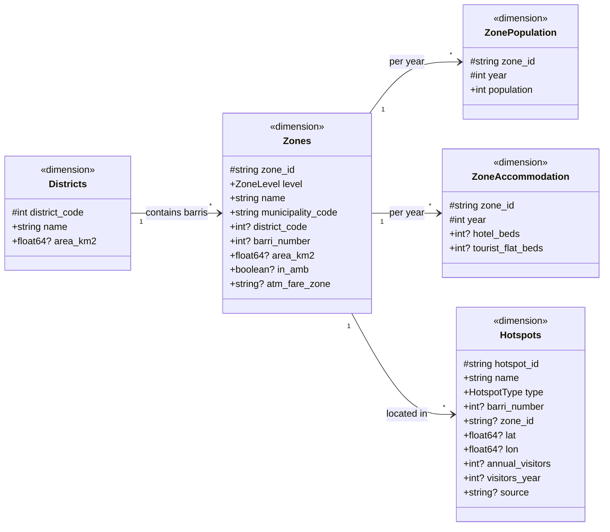
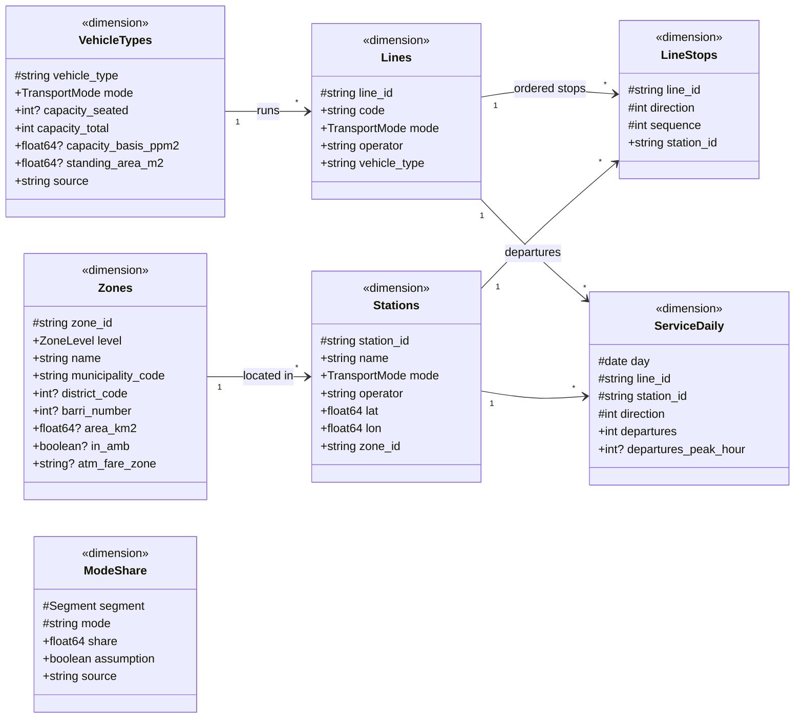
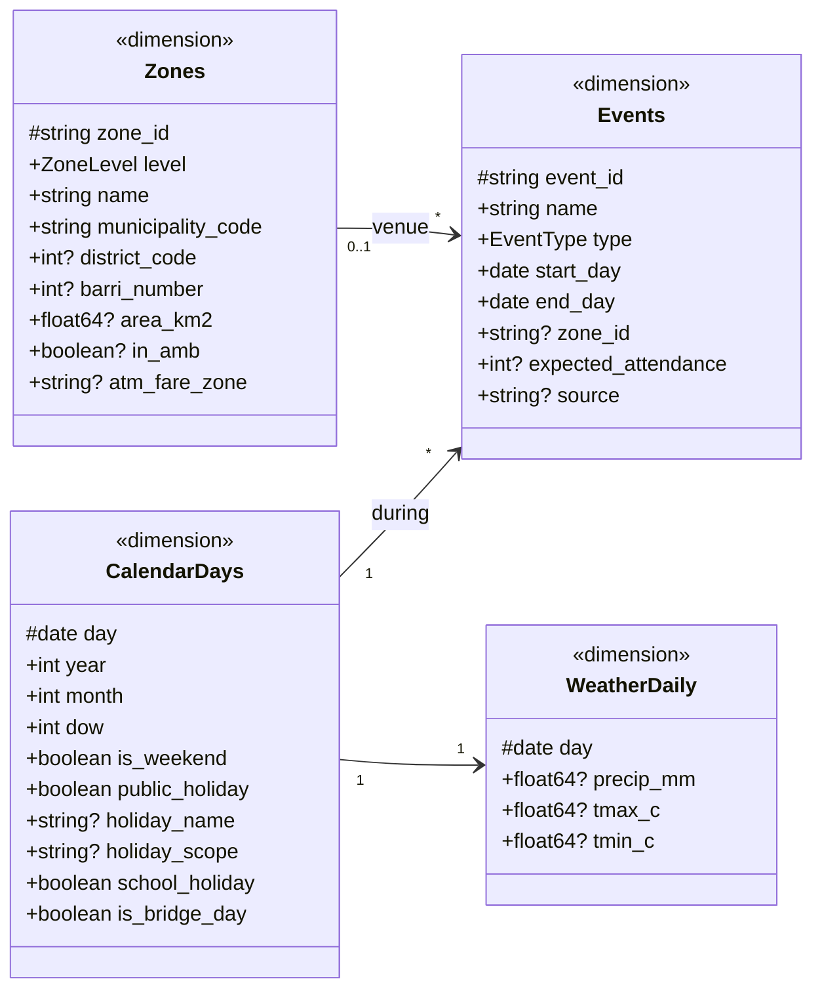
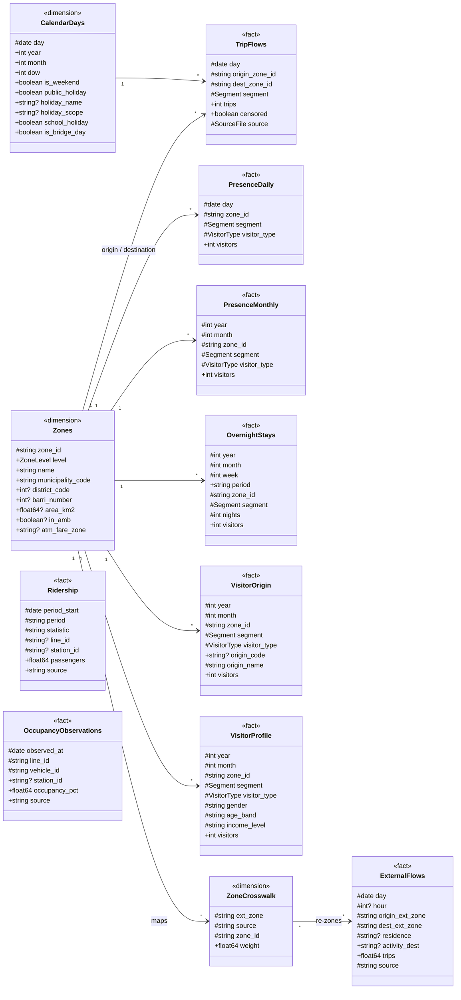
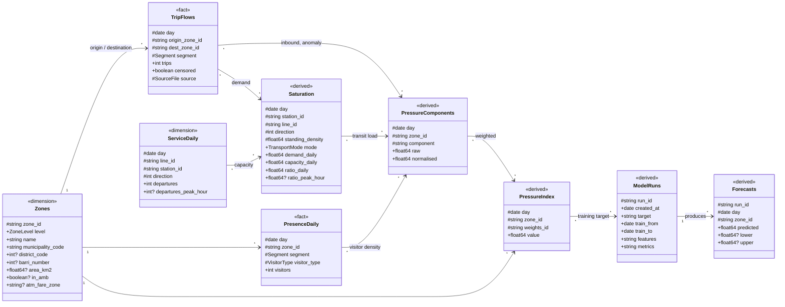
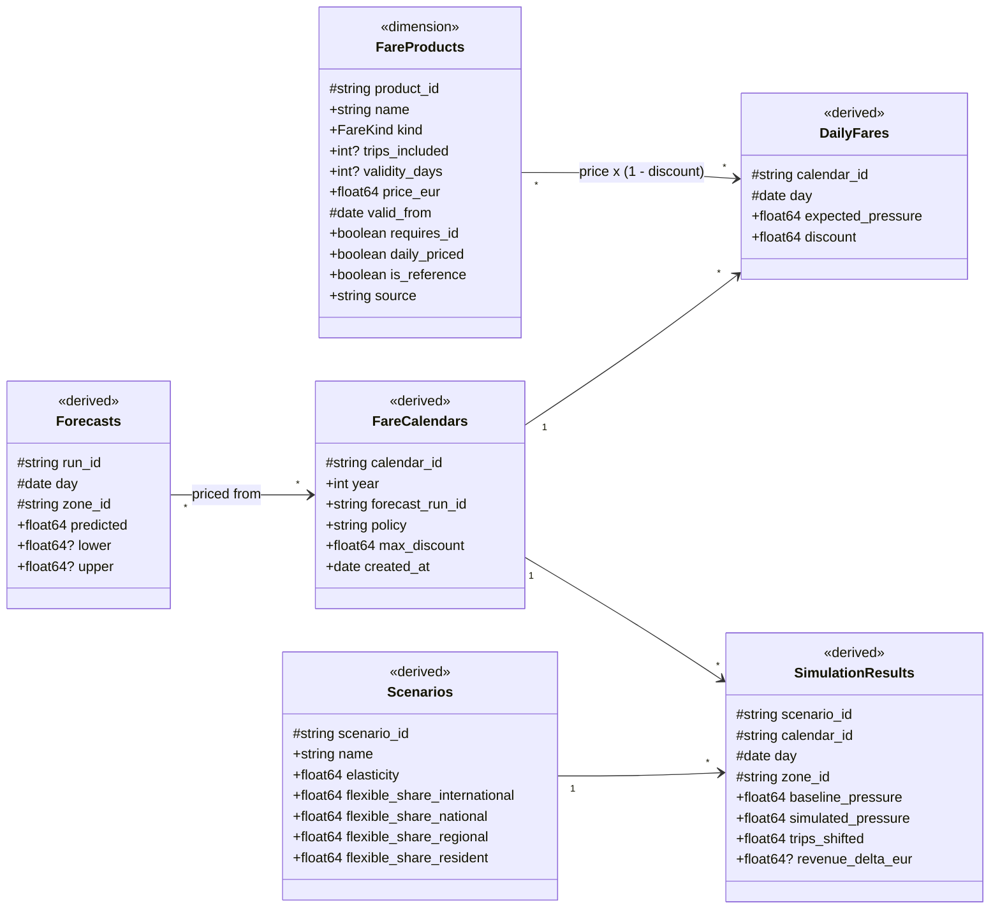

# PRISA data model

Generated from `src/prisa/schemas.py` by `uv run python -m prisa.uml`. Do not edit by hand.

`#` marks primary-key columns, `?` nullable ones.

## Geography and hotspots

## Transport network (supply)

## Calendar and context

## Observed demand

## Pressure, saturation and forecasts

## Pricing and simulation

## Table reference

### `zones` (dimension)

One row per barri of Barcelona and per municipality of the province.

| column | type | notes |
|---|---|---|
| `zone_id` (key) | string | 8-digit barri code (80190103) or 5-digit INE municipality code (08019) |
| `level` | ZoneLevel |  |
| `name` | string |  |
| `municipality_code` | string | 5-digit INE code, leading zero kept |
| `district_code` | Int64, nullable | 1-10, Barcelona barris only |
| `barri_number` | Int64, nullable | official 1-73 numbering, Barcelona barris only |
| `area_km2` | float64, nullable |  |
| `in_amb` | boolean, nullable | member of the Àrea Metropolitana de Barcelona |
| `atm_fare_zone` | string, nullable | ATM integrated fare zone |

Sources: Open Data BCN, INE, AMB, ATM

### `districts` (dimension)

| column | type | notes |
|---|---|---|
| `district_code` (key) | Int64 |  |
| `name` | string |  |
| `area_km2` | float64, nullable |  |

Sources: Open Data BCN

### `zone_population` (dimension)

| column | type | notes |
|---|---|---|
| `zone_id` (key) | string |  |
| `year` (key) | Int64 |  |
| `population` | Int64 | registered residents (padró) |

Sources: Open Data BCN, Idescat

### `zone_accommodation` (dimension)

Tourist bed capacity per barri. Tourist flats (HUT) are published per barri; hotel places only per district, so hotel_beds is null until geocoded.

| column | type | notes |
|---|---|---|
| `zone_id` (key) | string |  |
| `year` (key) | Int64 |  |
| `hotel_beds` | Int64, nullable |  |
| `tourist_flat_beds` | Int64, nullable | HUT places |

Sources: Open Data BCN habitatges-us-turistic, Observatori del Turisme

### `hotspots` (dimension)

| column | type | notes |
|---|---|---|
| `hotspot_id` (key) | string |  |
| `name` | string |  |
| `type` | HotspotType |  |
| `barri_number` | Int64, nullable | official 1-73; null for city-wide (Bus Turístic) |
| `zone_id` | string, nullable | resolved from barri_number once Telefónica's numbering is confirmed |
| `lat` | float64, nullable |  |
| `lon` | float64, nullable |  |
| `annual_visitors` | Int64, nullable |  |
| `visitors_year` | Int64, nullable |  |
| `source` | string, nullable |  |

Sources: Observatori del Turisme a Barcelona

### `stations` (dimension)

| column | type | notes |
|---|---|---|
| `station_id` (key) | string | operator prefix + GTFS stop_id, e.g. tmb:1.126 |
| `name` | string |  |
| `mode` | TransportMode |  |
| `operator` | string |  |
| `lat` | float64 |  |
| `lon` | float64 |  |
| `zone_id` | string | barri or municipality the stop falls in (spatial join) |

Sources: GTFS feeds

### `lines` (dimension)

| column | type | notes |
|---|---|---|
| `line_id` (key) | string | operator prefix + GTFS route_id |
| `code` | string | public name: L5, H12, V15, 116, T4, S1, R2... |
| `mode` | TransportMode |  |
| `operator` | string |  |
| `vehicle_type` | string | default vehicle; joins vehicle_types |

Sources: GTFS feeds

### `line_stops` (dimension)

| column | type | notes |
|---|---|---|
| `line_id` (key) | string |  |
| `direction` (key) | Int64 | GTFS direction_id |
| `sequence` (key) | Int64 |  |
| `station_id` | string |  |

Sources: GTFS feeds

### `vehicle_types` (dimension)

Capacity at a chosen density = seated + standing area x people per m2 (see saturation.capacity_at). We run 4 (European planning standard) and 6 (crush).

| column | type | notes |
|---|---|---|
| `vehicle_type` (key) | string | e.g. bus_12m, bus_18m, metro_l1, tram_citadis |
| `mode` | TransportMode |  |
| `capacity_seated` | Int64, nullable |  |
| `capacity_total` | Int64 | seated + standing as published |
| `capacity_basis_ppm2` | float64, nullable | standing density behind capacity_total, if stated |
| `standing_area_m2` | float64, nullable | floor area for standing; lets capacity be computed at any density |
| `source` | string |  |

### `service_daily` (dimension)

Expanded from GTFS calendars: how many vehicles actually pass each stop each day.

| column | type | notes |
|---|---|---|
| `day` (key) | datetime64[ns] |  |
| `line_id` (key) | string |  |
| `station_id` (key) | string |  |
| `direction` (key) | Int64 |  |
| `departures` | Int64 | scheduled vehicle departures that day |
| `departures_peak_hour` | Int64, nullable | departures in that stop's busiest hour |

Sources: GTFS feeds

### `mode_share` (dimension)

Default mode split per segment. EMEF counts walks of 5 minutes or less, which barri-to-barri phone trips mostly miss, so walking is likely overstated for our data. No weekend survey exists.

| column | type | notes |
|---|---|---|
| `segment` (key) | Segment |  |
| `mode` (key) | string | a TransportMode, or walk / bike / car_moto / taxi_vtc / other |
| `share` | float64 | fraction of the segment's weekday trips; sums to 1 per segment |
| `assumption` | boolean | true where the cell is our assumption, not a published figure |
| `source` | string |  |

Sources: EMEF 2024, Ajuntament PMU 2030, OTB perfil turistes 2024

### `calendar_days` (dimension)

| column | type | notes |
|---|---|---|
| `day` (key) | datetime64[ns] |  |
| `year` | Int64 |  |
| `month` | Int64 |  |
| `dow` | Int64 | 0 = Monday |
| `is_weekend` | boolean |  |
| `public_holiday` | boolean |  |
| `holiday_name` | string, nullable |  |
| `holiday_scope` | string, nullable | national / catalan / local |
| `school_holiday` | boolean |  |
| `is_bridge_day` | boolean | working day squeezed between a holiday and a weekend |

### `events` (dimension)

| column | type | notes |
|---|---|---|
| `event_id` (key) | string |  |
| `name` | string |  |
| `type` | EventType |  |
| `start_day` | datetime64[ns] |  |
| `end_day` | datetime64[ns] |  |
| `zone_id` | string, nullable | venue barri; null for city-wide events |
| `expected_attendance` | Int64, nullable |  |
| `source` | string, nullable |  |

### `weather_daily` (dimension)

Rain moves walkers onto transit; heat moves people to beaches.

| column | type | notes |
|---|---|---|
| `day` (key) | datetime64[ns] |  |
| `precip_mm` | float64, nullable |  |
| `tmax_c` | float64, nullable |  |
| `tmin_c` | float64, nullable |  |

Sources: AEMET OpenData

### `trip_flows` (fact)

All three mobility files in one table. Intra-zone trips are not in the data.

| column | type | notes |
|---|---|---|
| `day` (key) | datetime64[ns] |  |
| `origin_zone_id` (key) | string |  |
| `dest_zone_id` (key) | string |  |
| `segment` (key) | Segment |  |
| `trips` | Int64 |  |
| `censored` | boolean | published as 0 because the true count was below 15 |
| `source` (key) | SourceFile |  |

Sources: Telefónica Smart Steps

### `presence_daily` (fact)

T2 visitantes_unicos_municipio_date_dt and T5 visitantes_unicos_barrio_date_dt. A tourist here stayed at least one night in the month the day belongs to.

| column | type | notes |
|---|---|---|
| `day` (key) | datetime64[ns] |  |
| `zone_id` (key) | string | municipality (T2) or barri (T5) |
| `segment` (key) | Segment |  |
| `visitor_type` (key) | VisitorType |  |
| `visitors` | Int64 | unique visitors that day |

Sources: Telefónica Smart Steps

### `presence_monthly` (fact)

T1 visitantes_unicos_municipio_yearmon and T4 visitantes_unicos_barrio_yearmon. Never compare with the sum of daily values.

| column | type | notes |
|---|---|---|
| `year` (key) | Int64 |  |
| `month` (key) | Int64 |  |
| `zone_id` (key) | string | municipality (T1) or barri (T4) |
| `segment` (key) | Segment |  |
| `visitor_type` (key) | VisitorType |  |
| `visitors` | Int64 | unique visitors that month |

Sources: Telefónica Smart Steps

### `overnight_stays` (fact)

T3 pernoctaciones_semana. Length of stay = how many days a visitor could shift a trip.

| column | type | notes |
|---|---|---|
| `year` (key) | Int64 |  |
| `month` (key) | Int64 |  |
| `week` (key) | Int64 | week number as published |
| `period` | string | the week's date range as published |
| `zone_id` (key) | string | municipality only |
| `segment` (key) | Segment | international or national only |
| `nights` (key) | Int64 | nights spent in the municipality that week |
| `visitors` | Int64 | visitors who spent that many nights |

Sources: Telefónica Smart Steps

### `visitor_origin` (fact)

T6 visitantes_regionales_barrio_yearmon, T7 visitantes_nacionales_barrio_yearmon, T8 visitantes_internacionales_barrio_yearmon.

| column | type | notes |
|---|---|---|
| `year` (key) | Int64 |  |
| `month` (key) | Int64 |  |
| `zone_id` (key) | string | barri |
| `segment` (key) | Segment | regional (T6), national (T7) or international (T8) |
| `visitor_type` (key) | VisitorType | regional visitors are always day trippers |
| `origin_code` | string, nullable | INE municipality code; only published for regional visitors |
| `origin_name` (key) | string | municipality, province or country of residence; ANONYMISED for pooled groups |
| `visitors` | Int64 |  |

Sources: Telefónica Smart Steps

### `visitor_profile` (fact)

T9 visitantes_sociodemografico_barrio_yearmon. Lets the fairness analysis ask who the discount would reach (e.g. low-income visitors).

| column | type | notes |
|---|---|---|
| `year` (key) | Int64 |  |
| `month` (key) | Int64 |  |
| `zone_id` (key) | string | barri |
| `segment` (key) | Segment |  |
| `visitor_type` (key) | VisitorType |  |
| `gender` (key) | string | f / m / ANONYMISED |
| `age_band` (key) | string | 18-29 ... 70-99 / ANONYMISED |
| `income_level` (key) | string | Bajo / Medio / Medio-Alto / Alto / ANONYMISED |
| `visitors` | Int64 |  |

Sources: Telefónica Smart Steps

### `ridership` (fact)

Operator ridership at whatever grain is published (TMB: station x month, incl. average weekday; FGC: station x month; Renfe: station x 30 min, 2018). Ground truth for calibrating mode share.

| column | type | notes |
|---|---|---|
| `period_start` (key) | datetime64[ns] |  |
| `period` (key) | string | half_hour / hour / day / month / year |
| `statistic` (key) | string | total / avg_weekday / boardings / alightings |
| `line_id` (key) | string, nullable |  |
| `station_id` (key) | string, nullable |  |
| `passengers` | float64 | as published |
| `source` | string |  |

### `occupancy_observations` (fact)

Measured vehicle load. FGC Geotren publishes it live only, so we log it ourselves from now on; the only direct check on the saturation ratio.

| column | type | notes |
|---|---|---|
| `observed_at` (key) | datetime64[ns] | timestamp of the snapshot |
| `line_id` (key) | string |  |
| `vehicle_id` (key) | string |  |
| `station_id` | string, nullable | last/next stop at snapshot time |
| `occupancy_pct` | float64 | mean over cars, 0-100 |
| `source` | string |  |

Sources: FGC Geotren (CC BY 4.0)

### `external_flows` (fact)

Ministry of Transport (MITMA) big-data OD: hourly, Barcelona at district level only, Spanish residents only, daily to Jun 2025 then sample days. Gives the hourly profile Telefónica lacks.

| column | type | notes |
|---|---|---|
| `day` (key) | datetime64[ns] |  |
| `hour` (key) | Int64, nullable | 0-23; null where only daily totals exist |
| `origin_ext_zone` (key) | string | zone id in the source's own zoning |
| `dest_ext_zone` (key) | string |  |
| `residence` (key) | string, nullable | source's own residence/segment label |
| `activity_dest` | string, nullable | MITMA: casa / trabajo_estudio / frecuente / no_frecuente |
| `trips` | float64 |  |
| `source` (key) | string |  |

Sources: MITMA movilidad-opendata

### `zone_crosswalk` (dimension)

Maps another source's zoning onto our barris/municipalities.

| column | type | notes |
|---|---|---|
| `ext_zone` (key) | string |  |
| `source` (key) | string |  |
| `zone_id` (key) | string |  |
| `weight` | float64 | share of ext_zone that falls in zone_id (area or population) |

### `pressure_components` (derived)

Long format, so new components can be added without a schema change.

| column | type | notes |
|---|---|---|
| `day` (key) | datetime64[ns] |  |
| `zone_id` (key) | string |  |
| `component` (key) | string | see prisa.pressure.COMPONENTS |
| `raw` | float64 |  |
| `normalised` | float64 | 0-1, comparable across components |

### `pressure_index` (derived)

| column | type | notes |
|---|---|---|
| `day` (key) | datetime64[ns] |  |
| `zone_id` (key) | string |  |
| `weights_id` (key) | string | which weighting of the components produced this value |
| `value` | float64 | 0-1 |

### `saturation` (derived)

Load factor per stop and line: people passing / (vehicles x capacity).

| column | type | notes |
|---|---|---|
| `day` (key) | datetime64[ns] |  |
| `station_id` (key) | string |  |
| `line_id` (key) | string |  |
| `direction` (key) | Int64 |  |
| `standing_density` (key) | float64 | people per m2 assumed for capacity: 4 or 6 |
| `mode` | TransportMode |  |
| `demand_daily` | float64 | estimated boardings |
| `capacity_daily` | float64 | departures x vehicle capacity |
| `ratio_daily` | float64 |  |
| `ratio_peak_hour` | float64, nullable | same ratio in the busiest hour |

### `model_runs` (derived)

| column | type | notes |
|---|---|---|
| `run_id` (key) | string |  |
| `created_at` | datetime64[ns] |  |
| `target` | string | what is predicted, e.g. pressure_index:default |
| `train_from` | datetime64[ns] |  |
| `train_to` | datetime64[ns] |  |
| `features` | string | JSON list |
| `metrics` | string | JSON dict |

### `forecasts` (derived)

| column | type | notes |
|---|---|---|
| `run_id` (key) | string |  |
| `day` (key) | datetime64[ns] |  |
| `zone_id` (key) | string |  |
| `predicted` | float64 |  |
| `lower` | float64, nullable |  |
| `upper` | float64, nullable |  |

### `fare_products` (dimension)

| column | type | notes |
|---|---|---|
| `product_id` (key) | string | e.g. single, t_casual, t_usual, t_jove, t_dia |
| `name` | string |  |
| `kind` | FareKind |  |
| `trips_included` | Int64, nullable | null = unlimited |
| `validity_days` | Int64, nullable |  |
| `price_eur` | float64 | zone 1 price |
| `valid_from` (key) | datetime64[ns] |  |
| `requires_id` | boolean | personal title tied to DNI/NIE |
| `daily_priced` | boolean | each trip is charged at the discount of its boarding day; flat passes (T-usual, T-jove) are not |
| `is_reference` | boolean | the fare residents must never pay more than |
| `source` | string |  |

### `fare_calendars` (derived)

| column | type | notes |
|---|---|---|
| `calendar_id` (key) | string |  |
| `year` | Int64 |  |
| `forecast_run_id` | string |  |
| `policy` | string | one_price_for_all / registered_residents_capped |
| `max_discount` | float64 |  |
| `created_at` | datetime64[ns] |  |

### `daily_fares` (derived)

One discount per day for everyone. Product prices = base price x (1 - discount).

| column | type | notes |
|---|---|---|
| `calendar_id` (key) | string |  |
| `day` (key) | datetime64[ns] |  |
| `expected_pressure` | float64 | city-level forecast the discount is set from |
| `discount` | float64 | 0-1, continuous; discretise into tiers for display only |

### `scenarios` (derived)

| column | type | notes |
|---|---|---|
| `scenario_id` (key) | string |  |
| `name` | string |  |
| `elasticity` | float64 | trip shift per 1% price difference between days |
| `flexible_share_international` | float64 |  |
| `flexible_share_national` | float64 |  |
| `flexible_share_regional` | float64 |  |
| `flexible_share_resident` | float64 |  |

### `simulation_results` (derived)

| column | type | notes |
|---|---|---|
| `scenario_id` (key) | string |  |
| `calendar_id` (key) | string |  |
| `day` (key) | datetime64[ns] |  |
| `zone_id` (key) | string |  |
| `baseline_pressure` | float64 |  |
| `simulated_pressure` | float64 |  |
| `trips_shifted` | float64 |  |
| `revenue_delta_eur` | float64, nullable |  |

